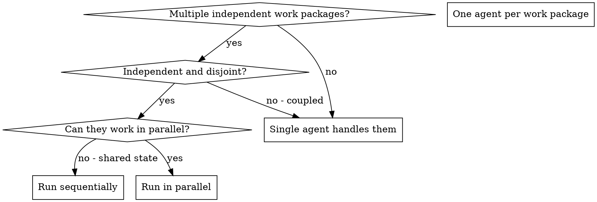

# Dispatching Parallel Agents

## Overview

You delegate tasks to specialized agents with isolated context. By precisely crafting their instructions and context, you ensure they stay focused and succeed at their task. Prefer a fresh or bounded context and supply the task's required inputs explicitly, using the active harness's controls. This also preserves your own context for coordination work.

When you have multiple independent work packages — unrelated failures,
separate investigations, independent comparisons, or disjoint implementation
tasks — handling them sequentially can waste time. The number of items is not
the trigger; disjoint ownership and a real parallel benefit are.

**Core principle:** Dispatch one agent per independent work package. Let them work concurrently.

## When to Use



**Use when:**
- Parallel benefit clearly exceeds coordination cost
- Work packages are independent and have disjoint write sets
- Each problem can be understood without context from others
- No shared state between investigations
- The harness has enough capacity to run them concurrently without starving the main task

The number of failures or files is not itself a trigger: two independent
packages can justify parallel work, while ten related failures may not.

**Don't use when:**
- Work packages are related (fixing one may change another)
- Need to understand full system state
- Agents would interfere with each other
- The main agent can finish the work in one pass with less coordination

## The Pattern

### 1. Identify Independent Work Packages

Group work by what it produces or investigates:
- Failure triage: File A tests, File B tests, File C tests
- Independent comparisons: image-parallel runs, parameter sweeps
- Disjoint implementation packages: separate modules or repositories

Each package should be understandable without the others and have a disjoint
write set. A shared output directory, service or Git index makes the packages
coupled even when their source files differ.

### 2. Create Focused Agent Tasks

Each agent gets:
- **Specific scope:** One work package with disjoint ownership
- **Clear goal:** The observable result the package must produce
- **Constraints:** Don't change other packages' files, shared state or Git index
- **Acceptance evidence:** The exact command(s) or observation that prove the
  package done and the expected output — so "done" is checkable, not claimed
- **Fatal-flaw binding (fork-added, ARFT F.4):** discovering a fatal defect
  means stop and report. Every "something is wrong" finding must carry a
  disposition — fix, escalate, or rule-and-record with its cost. Never log
  it and continue.
- **Expected output:** Summary of what was produced or found, plus evidence

### 3. Dispatch in Parallel

Start independent tasks through the active harness's native dispatch interface
before waiting for their results, where asynchronous or concurrent dispatch is
supported. Apply the capability-aware routing and fallback rules
in your harness's routing reference (`references/*-tools.md`), classifying each
domain independently as routine or standard.

```text
Subagent (matching implementer capability): "Complete image-parallel comparison for the 3-image case"
Subagent (matching implementer capability): "Complete image-parallel comparison for the 4-image case"
Subagent (matching implementer capability): "Complete image-parallel comparison for the 5-image case"
# Disjoint output directories; all three run concurrently.
```

Concurrency depends on overlapping task execution, not response boundaries.
Use the live slot budget and its counting convention; queue excess work and
reuse retained agents when supported. Transport, resume, and wait behavior
belong in the active harness reference.

### 4. Review and Integrate

When agents return:
- Read each summary
- Verify fixes don't conflict
- Run the checks covering the combined changes; broaden when risk warrants it
- Integrate all changes

## Agent Prompt Structure

Good agent prompts are:
1. **Focused** - One clear work package
2. **Self-contained** - All context needed to understand the problem
3. **Specific about output** - What should the agent return?

```markdown
Fix the 3 failing tests in src/agents/agent-tool-abort.test.ts:

1. "should abort tool with partial output capture" - expects 'interrupted at' in message
2. "should handle mixed completed and aborted tools" - fast tool aborted instead of completed
3. "should properly track pendingToolCount" - expects 3 results but gets 0

These are timing/race condition issues. Your task:

1. Read the test file and understand what each test verifies
2. Identify root cause - timing issues or actual bugs?
3. Fix by:
   - Replacing arbitrary timeouts with event-based waiting
   - Fixing bugs in abort implementation if found
   - Adjusting test expectations if testing changed behavior

Do NOT just increase timeouts - find the real issue.

Return: Summary of what you found and what you fixed.
```

## Common Mistakes

The examples below use test triage; the same rules apply to comparisons and
implementation packages.

**❌ Too broad:** "Fix all the tests" - agent gets lost
**✅ Specific:** "Fix agent-tool-abort.test.ts" - focused scope

**❌ No context:** "Fix the race condition" - agent doesn't know where
**✅ Context:** Paste the error messages and test names

**❌ No constraints:** Agent might refactor everything
**✅ Constraints:** "Do NOT change production code" or "Fix tests only"

**❌ Vague output:** "Fix it" - you don't know what changed
**✅ Specific:** "Return summary of root cause and changes"

## When NOT to Use

**Related packages:** Fixing or changing one may affect others - investigate together first
**Need full context:** Understanding requires seeing entire system
**Exploratory work:** You do not yet know what the independent packages are
**Shared state:** Agents would interfere (editing same files, using same resources)
**Decision-phase artifacts (fork-added):** SPECs, plans, and acceptance
criteria are main-agent work — their input is the conversation itself.
Subagents gather, enumerate, and draft; decision points route back to the
main agent and the human.

**Implementation with a review gate:** use subagent-driven-development to
coordinate each package's implementation, review, and repair sequence.
Independent packages may overlap when ownership and write sets are disjoint,
there is no shared generated state, and each review has an attributable
snapshot. Dependencies, shared files, and shared Git index mutations stay
serial. A package's review follows its implementation; selected reviews still
finish before acceptance.

## Verification

After agents return:
1. **Review each summary** - Understand what changed
2. **Check for conflicts** - Did agents edit same code?
3. **Verify integration** - Run checks covering the combined changes; broaden when warranted
4. **Spot check** - Agents can make systematic errors
